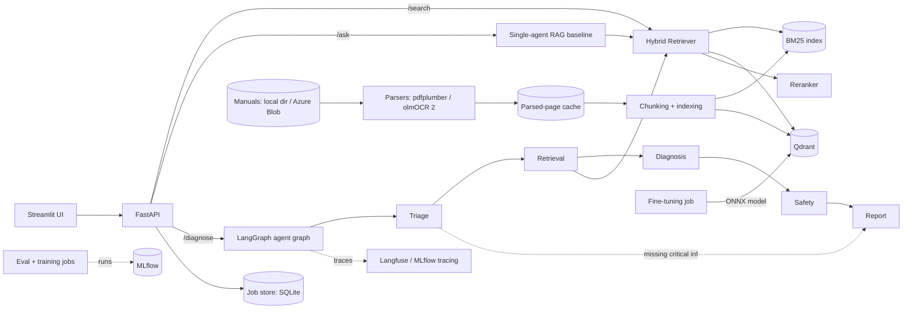

# Rig Assist — Project Plan

A multi-agent troubleshooting assistant for oil & gas equipment. A technician describes a fault ("pump P-101 vibrating, discharge pressure dropping"); a team of agents retrieves relevant manual sections, diagnoses likely causes, checks safety, and returns a structured, cited work order through a REST API.

This is v2 of my earlier project, [offshore-drilling-rag](https://github.com/Riz695/offshore-drilling-rag) (v1): a local hybrid RAG over the same manuals. v1 already has pypdf + pdfplumber parsing, ~500-token chunks, `bge-small-en-v1.5` embeddings in ChromaDB, BM25 fused with RRF, a citation check (every cited page must be a retrieved chunk), FastAPI + Ollama, a Streamlit UI, and a Hugging Face Space deployment.

v2 does **not** claim those as new. What v2 adds over v1:
- **Measured evaluation.** v1 has no eval set or metrics, and its relevance cut-off (`dense_score >= 0.6`) was picked from a few observed scores. v2 builds a frozen eval set and reports retrieval and answer metrics, **with v1's pipeline as the baseline**.
- **OCR ingestion** with a vision-language model (olmOCR 2, open weights), so all 6 manuals are searchable (v1: 5 of 6, the scanned one was skipped), with a measured parser comparison.
- A cross-encoder reranker and a **fine-tuned embedding model** (PyTorch), each compared against v1's hybrid setup on the same eval set.
- **Experiment tracking** with MLflow: every number in the README traces back to a logged run.
- Multi-agent orchestration with **LangGraph**: a safety node that can block actions, enforced in code, returning a structured, cited work order.
- An async job API, Docker, CI/CD, tracing, and Azure deployment.

**Purpose:** portfolio project for ML/AI engineer roles. Code quality, clear README, and *measured results* matter more than feature count.

---

## Instructions for Claude Code

- Work **one phase at a time**, in order. At the end of each phase: run lint + tests, summarize what was built, list anything deferred, and **stop for my review** before starting the next phase.
- Each phase has acceptance criteria. A phase is done only when all of them pass.
- LLM/agent framework APIs change quickly. **Before writing code against LangGraph, Qdrant, fastembed, sentence-transformers, MLflow, Langfuse, olmOCR, Docker Cloud Sandboxes (`sbx`), or Azure SDKs, check the current official docs** rather than relying on memory. Pin the versions you use.
- Never commit secrets. All config goes through environment variables, documented in `.env.example`.
- Prefer simple, readable code over clever abstractions. This repo will be read by recruiters and interviewers.
- **Test-driven development for core logic.** For anything listed under "Tests first" in a phase, write the failing tests *before* the implementation, run them to confirm they fail for the right reason, then implement until they pass (red → green → refactor). Commit tests and implementation as separate commits so the history shows test-first. Glue code, UI, and infra config don't need test-first, but they still need tests where practical.
- LLM calls must be mockable (fake LLM backend) so tests run offline, deterministic, and free. Real-LLM checks belong in the eval scripts, not the unit test suite.
- If something in this plan turns out to be a bad idea in practice, say so and propose an alternative instead of forcing it.

### Teaching mode: explain every technical task, and keep notes in Obsidian

I'm building this to learn and to be able to explain every part of it in job interviews. So this project runs in teaching mode:

- **After every technical task** (each test file, module, endpoint, Dockerfile, workflow, cloud resource, or important command), stop and explain it to me in detail **before starting the next task**:
  1. **What** you built and which files changed.
  2. **How it works**, walking through the key code step by step. Name the actual functions and lines rather than speaking abstractly.
  3. **Why** it's designed this way, which alternatives existed, and what the tradeoffs are.
  4. **Concepts** behind it, explained from fundamentals for a fresh grad (e.g. what BM25 scoring actually computes, how reciprocal rank fusion works, what a multi-stage Docker build does, how OIDC auth works).
  5. **Interview angle:** 1–3 questions an interviewer might ask about this part, with good answers.
  6. **How to check it myself:** a command to run or something to look at.
- Then **wait for me** to reply "continue" or ask questions before moving on. Answer my questions fully; if a question shows I've misunderstood something, correct it clearly.
- Plain language first, jargon second. When you use a term for the first time, define it.

**Learning notes: in my Obsidian vault, outside the repo**

Write all learning notes as Markdown files into my existing Obsidian vault, in this folder:

`/home/riz/Documents/Obsidian Vault/Claude/Rig Assist/`

- The path contains spaces, so always quote it in shell commands.
- This folder is **outside the repo**. Never write notes into the repo, and never commit or push them.
- In Phase 0, check that you can write to this folder (create the layout below). If you don't have access, stop and tell me so I can grant it.
- Only touch files inside `Claude/Rig Assist/`. Don't read, change, or reorganize anything else in my vault, and never edit the vault's `.obsidian/` settings.

Folder layout (create it in Phase 0):
```
/home/riz/Documents/Obsidian Vault/Claude/Rig Assist/
├── 00 Index.md            # map of contents: links to every task note, grouped by phase
├── Glossary.md            # every term, one line each, alphabetical, linked to its concept note
├── Interview Questions.md # all interview Q&A collected in one place, linked back to sources
├── Tasks/                 # one note per technical task
│   └── P2 - Hybrid retriever.md
└── Concepts/              # one note per concept, reused across tasks
    ├── BM25.md
    └── Reciprocal Rank Fusion.md
```

Rules:
- **One task note per technical task**, written right after the explanation. Use this template:
  ```markdown
  ---
  date: YYYY-MM-DD
  phase: 2
  tags: [task, retrieval]
  files: [src/rig_assist/retrieval/hybrid.py, tests/test_hybrid.py]
  ---
  # P2 - Hybrid retriever
  ## What
  ## How it works
  ## Why / tradeoffs
  ## Concepts
  Links: [[BM25]], [[Reciprocal Rank Fusion]], [[Dense retrieval]]
  ## Interview Q&A
  ## Try it
  ## My questions & answers
  ```
- **Concepts get their own notes**, linked with `[[wikilinks]]`. Before creating a concept note, check whether it already exists. If it does, add to it (a new section, or "Seen again in [[P5 - ...]]") instead of making a duplicate. This builds a connected knowledge graph rather than a pile of entries.
- Use Obsidian features where they help understanding: Mermaid diagrams for flows and architecture, callouts (`> [!tip]`, `> [!warning]`) for gotchas, and code blocks with language tags.
- Append the answers to my follow-up questions to the relevant task note. Never delete earlier content; corrections go in as a `> [!note] Correction` callout with the date.
- Update `00 Index.md`, `Glossary.md`, and `Interview Questions.md` every time you add a note.
- At the end of every explanation, confirm which note files you created or updated.

### Git and GitHub workflow (backup and history)

The GitHub remote is the backup. Push often, so nothing is lost if the session, the machine, or the code breaks.

- **Setup (Phase 0): create the GitHub repo yourself** with the GitHub CLI:
  1. Check that `gh auth status` shows I'm logged in. If I'm not, stop and ask me to run `gh auth login`. Never handle my GitHub password or tokens yourself.
  2. Create the repo: `gh repo create rig-assist --public --description "Multi-agent troubleshooting assistant for oil & gas equipment (RAG + CrewAI + FastAPI + Azure)" --source . --remote origin`. If the name is taken, ask me for another.
  3. Add topics: `gh repo edit --add-topic rag,llm,multi-agent,crewai,llamaindex,fastapi,docker,azure,machine-learning`.
  4. Make the first commit (`.gitignore`, `PLAN.md`), push it to `main`, and confirm the push succeeded before writing any other code. If any step fails, stop and tell me; don't continue with work that only exists locally.
- **Branch per phase:** `phase-0-scaffold`, `phase-1-api`, and so on. Push the branch to GitHub as soon as it's created (`git push -u origin <branch>`).
- **Commit small, push immediately:** commit at every meaningful step (failing tests written, tests passing, refactor done) and **push after every commit**. Never leave more than ~30 minutes of work unpushed.
- **Before risky changes** (large refactors, dependency upgrades, deleting files), make sure everything is committed and pushed first, so it can be rolled back.
- **End of phase:** all tests passing → push → open a pull request into `main` with a summary of the phase → **stop for my review.** I merge it. Don't merge to `main` yourself, especially from Phase 8 on, when `main` triggers deployment.
- **Commit messages:** Conventional Commits (`test: add RRF fusion tests`, `feat: hybrid retriever`, `fix: ...`, `chore: ...`).
- **Never:** force-push, rewrite pushed history, push directly to `main` after Phase 0, or commit secrets, `.env`, `data/index/`, model weights, or the manuals in `data/raw/`. Check `.gitignore` and `git status` before each commit.
- **If something goes wrong,** recover from git (`git revert`, or check out the last good commit) rather than hand-reconstructing files, and tell me what happened.

---

## Decisions (defaults; edit before starting)

| Decision | Default | Notes |
|---|---|---|
| Language / tooling | Python 3.11+, `uv`, `ruff`, `pytest`, `mypy` (lenient) | |
| API | FastAPI + Pydantic v2 | Swagger UI at `/docs` |
| PDF parsing | Pluggable parsers: `pdfplumber` (local default, text + tables) and **olmOCR 2** only (open-weights VLM, Apache 2.0, via an OpenAI-compatible endpoint) | OCR runs once at ingestion and is cached; never on the request path. The two parsers are compared on the eval set (Phase 3). No other OCR service |
| Chunking / BM25 / RRF | Port from v1 (read critically, adapt, add the missing tests) | No LlamaIndex: v1's chunking already works. v1's pipeline is the eval baseline |
| Embeddings | `BAAI/bge-small-en-v1.5` via `fastembed` (ONNX), then a **fine-tuned** version (Phase 5) | Serving stays ONNX/CPU, no PyTorch in the API image; swappable via config |
| Reranker | Cross-encoder `BAAI/bge-reranker-base` via `fastembed`; fine-tuning optional (Phase 5) | Optional toggle |
| Fine-tuning | PyTorch + `sentence-transformers`, in a separate `train` dependency group (CPU torch wheels) | Exported to ONNX for serving. Small models only |
| Vector DB | Qdrant (Docker locally; Qdrant Cloud free tier in prod) | Not a Container App on Azure Files: Qdrant warns against network filesystems (risk of corruption) |
| Multi-agent framework | **LangGraph** | Explicit state graph: safety precedence and escalation are enforced in code (graph edges + deterministic merge), not by prompt. Agents stay behind an interface |
| LLM | Azure OpenAI in prod; OpenAI API locally | Provider + model set via env vars |
| Experiment tracking | **MLflow** (local file store or compose service) | Every eval, parser comparison, and fine-tune run is logged; model registry for the fine-tuned embedder |
| Tracing | Langfuse Cloud (free tier), **or MLflow 3 tracing** if it covers LangGraph well; decide in Phase 6 after checking docs | Optional either way: everything works without keys |
| Long CPU jobs | **Docker Cloud Sandboxes** ($250 credit), see "Compute" below | Acceleration only: every job also runs locally |
| Frontend | Streamlit | Thin demo UI only |
| Cloud | Azure: Container Apps, Container Registry, Blob Storage, Azure OpenAI | |
| CI/CD | GitHub Actions | |

---

## Compute: Docker Cloud Sandboxes ($250 credit)

I have $250 of Docker Cloud Sandboxes credit. Use it wherever a job is long and CPU-bound, so my laptop (no NVIDIA GPU, 14 GB RAM) isn't tied up for hours.

**Use it for:**
- Full-corpus ingestion and embedding (all manuals, every parser's output).
- Eval sweeps: every retrieval mode × every parser × v1 baseline (Phase 3), answer eval (Phase 4), agent scenario comparison (Phase 6).
- Fine-tuning the embedding model and reranker, plus hard-negative mining (Phase 5).
- Any other job expected to take more than ~20 minutes locally.

**Don't use it for:** GPU work (none documented), OCR (that's an external API call), unit tests (CI does that), or hosting the demo (sessions last at most 24 hours; Azure hosts the demo).

**Rules:**
- **Verify before relying on it** (first use, Phase 1 or 3): install `sbx` on Linux, and confirm how code and data get in, how secrets are passed (its secret proxy, never baked into files), whether Docker/compose and Qdrant run inside, and how results and MLflow runs come back. Write this up in `docs/cloud-jobs.md`, with the exact commands.
- **Same commands as local:** jobs run through `make` targets (`make ingest`, `make eval`, `make train`), so results are reproducible without the credit.
- **Budget tracking:** log every run in `PROGRESS.md` (job, sandbox size, hours, cost, credit left). Estimate the cost first and **ask me before any single run estimated above $20**. Stop or pause sandboxes when a job ends (a paused sandbox costs nothing).
- **Expiry:** the credit expires 6 months after it was claimed. Record the claim date in `PROGRESS.md` and plan heavy jobs before it.
- **Not covered by the credit:** LLM, OCR, and other API costs (synthetic queries, LLM judge, OCR). Estimate those separately and ask before spending.
- **Data:** the manuals are uploaded only into my own sandboxes, never to public images or repos.

---

## Architecture



---

## Repository structure

```
rig-assist/
├── PLAN.md
├── PROGRESS.md              # state: done tasks, decisions, credit usage
├── CLAUDE.md
├── README.md
├── pyproject.toml
├── .env.example
├── Makefile                 # make dev / test / lint / ingest / eval / train / up
├── docker-compose.yml       # api, qdrant, ui (mlflow optional)
├── Dockerfile               # api image, multi-stage
├── docs/
│   ├── cloud-jobs.md        # running long jobs in Docker Cloud Sandboxes
│   └── deployment.md
├── ui/
│   ├── Dockerfile
│   └── app.py
├── src/rig_assist/
│   ├── config.py            # pydantic-settings
│   ├── api/
│   │   ├── main.py
│   │   ├── routes/          # health, documents, search, ask, diagnose, jobs
│   │   └── schemas.py       # request/response models
│   ├── ingestion/
│   │   ├── parsers/         # pdfplumber, olmocr (one interface)
│   │   ├── cache.py         # parsed-page cache keyed by (file hash, page, parser)
│   │   ├── chunking.py
│   │   └── pipeline.py      # parse → chunk → index (both indexes)
│   ├── retrieval/
│   │   ├── bm25.py
│   │   ├── dense.py
│   │   ├── hybrid.py        # reciprocal rank fusion
│   │   └── rerank.py
│   ├── llm/                 # provider-agnostic client wrapper + fake backend
│   ├── rag/                 # single-agent baseline
│   ├── agents/
│   │   ├── graph.py         # LangGraph state graph
│   │   ├── nodes.py         # triage, retrieval, diagnosis, safety, report
│   │   ├── state.py
│   │   └── models.py        # WorkOrder etc.
│   └── jobs/                # job store + background runner
├── training/
│   ├── make_pairs.py        # synthetic queries + hard negatives
│   ├── train_embedder.py
│   ├── train_reranker.py    # optional
│   └── export_onnx.py
├── eval/
│   ├── questions.jsonl      # built from the manuals (see Phase 3)
│   ├── scenarios.jsonl      # Phase 6
│   ├── run_retrieval_eval.py
│   ├── run_answer_eval.py
│   ├── CHANGELOG.md
│   └── results/             # committed markdown result tables
├── data/
│   ├── raw/                 # manuals (gitignored)
│   ├── parsed/              # OCR / parser cache (gitignored)
│   └── index/               # gitignored
├── tests/
└── .github/workflows/
    ├── ci.yml
    └── deploy.yml
```

---

## Phase 0: Scaffold

**Tasks**
- Init the project with `uv`, `ruff`, `pytest`, pre-commit hooks.
- `config.py` with pydantic-settings; `.env.example` listing every variable.
- `Makefile` with the targets listed above.
- Minimal FastAPI app with `GET /health`.
- `ci.yml`: lint + test on push/PR.

**Acceptance**
- `make lint` and `make test` pass locally and in GitHub Actions.
- `GET /health` returns `{"status": "ok", "version": ...}`.

---

## Phase 1: Port v1 + OCR ingestion + API + Docker

**Data:** the manuals (PDFs) are in `data/raw/`: 6 files, 982 pages. `MarineOffshoreLogOpsManual.pdf` (146 pages) is a scan with no text layer; v1 skipped it.

**Tests first**
- Chunking: chunk size/overlap respected, page and doc metadata preserved, no empty chunks, tables not split mid-row where avoidable.
- BM25: known query returns the known chunk first on a small fixture corpus; empty query and no-match behave sensibly.
- Parsers (with a fake OCR client, no network): one interface for all backends; pages without a text layer are detected and routed to OCR when it's configured (and reported, not silently dropped, when it isn't); output keeps page numbers; the cache returns stored pages without calling the API again; API errors are retried a bounded number of times and then surface clearly.
- API contracts: `/documents` and `/search` request validation, response schemas, and error codes (bad file type, unknown mode, empty index).

**Tasks**
- Check the current olmOCR docs (model ID, prompt and request format, image size, limits) before writing the client.
- **Provider risk:** DeepInfra deprecated olmOCR 2 on 2026-05-07, and the olmOCR README's provider list (Jan 2026) is out of date. Before building on a provider, make one test call (a single page, under $0.001) to confirm it serves `olmOCR-2-7B-1025`. Order to try: Parasail ($0.10 / $0.20 per 1M input/output tokens), then Cirrascale ($0.07 / $0.15). Fallback if no hosted endpoint works: run olmOCR 2 with vLLM on a rented GPU by the hour (the official `olmocr` pipeline), estimate the cost and ask me first. The client only needs an OpenAI-compatible base URL, so switching providers is a config change.
- Parsers behind one interface: `pdfplumber` (local, text + tables as Markdown, default), `olmocr` (olmOCR 2 via an OpenAI-compatible endpoint). Chosen by env var; OCR can be per-page (only pages with no text layer) or per-document.
- Parsed-page cache in `data/parsed/`, keyed by file hash + page + parser, so OCR runs once per page.
- Estimate the OCR cost for the full corpus (planning estimate: about $0.0005 per page, so roughly $0.10 for the scanned manual and under $1 for all 982 pages), ask me, then OCR the scanned manual and, for the Phase 3 comparison, the whole corpus. Log the real cost in `PROGRESS.md`.
- Ingestion: chunk the parsed pages (ported from v1), keeping metadata `doc_id`, `doc_title`, `page`, `section` (when detectable), `parser`.
- Port the BM25 retriever from v1 (`src/rag/bm25_index.py`) and persist the index to `data/index/`.
- Endpoints:
  - `POST /documents`: upload a PDF, ingest and index it, return `doc_id` and chunk count.
  - `GET /documents`: list indexed documents.
  - `POST /search`: `{query, top_k, mode}` → ranked chunks with scores and metadata. `mode` is only `bm25` for now.
- Full Pydantic request/response models with examples, so the Swagger page is self-explanatory.
- `Dockerfile` (multi-stage, non-root user) and `docker-compose.yml`.
- Verify Docker Cloud Sandboxes for long jobs and write `docs/cloud-jobs.md` (see "Compute"). Use it for the full-corpus ingestion if that's slow locally.

**Acceptance**
- `docker compose up` → upload a manual through Swagger UI → `/search` returns relevant chunks with page numbers.
- With OCR configured, all 6 manuals are searchable, including the scanned one.
- Unit tests for chunking, BM25 and parsers; API tests using FastAPI `TestClient`.

---

## Phase 2: Hybrid retrieval + rerank

**Tests first**
- RRF fusion: correct scores and ordering on hand-computed fake rankings, ties, a document present in only one list, `k` parameter.
- Idempotent ingestion: re-ingesting the same document leaves chunk counts unchanged in both indexes.
- Mode dispatch: each `mode` routes to the right retriever (use fakes).

**Tasks**
- Dense retrieval: embed chunks with `fastembed` into Qdrant (add a Qdrant service to compose).
- Hybrid: reciprocal rank fusion of BM25 + dense.
- Cross-encoder rerank on the fused top-N.
- `/search` `mode` supports `bm25 | dense | hybrid | hybrid_rerank`.
- A `v1_baseline` configuration that reproduces v1's retrieval settings (its chunking, top-20 per retriever, RRF k=60, top-5) for the Phase 3 comparison.
- Ingestion writes to both indexes. Re-ingesting the same document must not duplicate chunks.

**Acceptance**
- All four modes work through the API.
- Tests for RRF fusion logic, using deterministic fake rankings.

---

## Phase 3: Evaluation (the most important phase for the portfolio)

**Tests first**
- Metric functions (Hit@k, MRR@k) against hand-computed examples, including edge cases (no relevant result, relevant at rank 1, multiple relevant pages).
- Eval set validator: rejects missing fields, unknown `doc_id`, pages out of range, duplicate IDs.
- Refusal metrics: precision/recall of "not found" on answerable vs unanswerable questions, for a given relevance threshold.

**Eval set:** Claude Code builds `eval/questions.jsonl` (40–60 entries) by **reading the manuals in `data/raw/` directly**:
```json
{"id": "q001", "question": "...", "expected_doc_id": "...", "expected_pages": [12, 13], "reference_answer": "...", "evidence_quote": "...", "type": "factual|troubleshooting|procedure|table|unanswerable", "difficulty": "easy|medium|hard"}
```
Rules, so the set isn't biased or too easy:
- **Build it before tuning retrieval**, then freeze it. Don't change questions afterwards to make a pipeline look better. Changes after freezing need a logged reason in `eval/CHANGELOG.md`.
- Every answerable question must include an `evidence_quote` copied from the stated page. The validator checks the quote appears in that page's reference text: the text layer for normal pages, the OCR output for scanned pages (and those quotes are also spot-checked by me against the page image).
- Ground truth is **doc + page**, which doesn't depend on the parser, so parser comparisons are fair.
- **Paraphrase questions** rather than reusing manual wording. Questions copied from the text unfairly favor BM25. Include a mix: roughly 30% using different vocabulary from the manual (synonyms, symptom descriptions a technician would say).
- Spread questions across all manuals and sections, including the scanned manual and table pages, not just the first chapters.
- Mix types: factual lookups, multi-step procedures, troubleshooting (symptom → cause), facts inside tables, and about 10% **unanswerable** questions whose answer is not in the manuals (expected behavior: "not found").
- Write `eval/README.md` explaining how the set was generated and its known limitations (LLM-generated, single annotator).
- After generating, print a random sample of 10 questions with their evidence so I can spot-check them, and stop for my review before using the set.

**Retrieval eval:** `run_retrieval_eval.py` computes Hit@1, Hit@5, and MRR@10, plus p50/p95 latency, for:
- every mode (`bm25`, `dense`, `hybrid`, `hybrid_rerank`) and `v1_baseline`;
- every parser (`pdfplumber`, `olmocr`), reported overall and for table questions and scanned-manual questions separately;
- the relevance threshold for "not found": v1's fixed 0.6 vs a threshold chosen on the eval set (report refusal precision/recall, and note the risk of tuning on the test set).

Each run is logged to **MLflow** (params: parser, mode, models, k, threshold; metrics; the results table as an artifact). Markdown tables are written to `eval/results/` and committed. Run the full sweep in a Docker Cloud Sandbox if it's slow locally.

**Answer eval** (after Phase 4): `run_answer_eval.py` scores faithfulness (is the answer grounded in the retrieved context?) and correctness against `reference_answer`, using a **documented LLM-as-judge prompt** as the primary metric. Keep the judge prompt in the repo, ask for a structured score plus a short reason, and test the scoring/parsing code with the fake LLM. RAGAS is an optional extra only (its API changes often); if used, pin its version. Report results per pipeline, logged to MLflow.

**Acceptance**
- `make eval` reproduces the tables.
- Results are committed. The README will quote v1 baseline vs v2 numbers, and the parser comparison, whatever they turn out to be. If something doesn't win, that's fine; report it honestly.

---

## Phase 4: Single-agent RAG baseline

**Tests first**
- Fake LLM backend behaves deterministically and records prompts.
- `/ask` returns citations that reference only chunks actually retrieved (no invented doc/page). Start from v1's citation check.
- "Not found" path: when retrieval returns nothing relevant, the response says so without calling the LLM to make something up.
- Usage tracking: token and cost totals computed correctly from fake usage data.

**Tasks**
- `llm/` wrapper: one interface, with OpenAI and Azure OpenAI backends chosen by env var, plus a fake backend for tests. Check whether Azure's v1 endpoint lets both share the `openai` client.
- `POST /ask`: `{question}` → `{answer, citations[{doc_id, page, snippet}]}`. The answer must cite sources and must say "not found in the manuals" when the context doesn't support an answer.
- Track tokens, cost estimate, and latency per request.

**Acceptance**
- Works end to end via Swagger.
- Answer eval runs on this pipeline.
- Tests use the fake LLM.

---

## Phase 5: Fine-tuning the retriever

Goal: a **measured** improvement on oil & gas vocabulary from domain-adapting the embedding model (and optionally the reranker), served exactly like the base model.

**Tests first**
- Training-pair builder: deterministic given a seed; no duplicate pairs; **every page listed in `eval/questions.jsonl` `expected_pages` is excluded** from training positives (leakage guard); train/validation split is stable.
- Hard-negative mining: negatives never include the positive chunk or chunks from the same page.
- ONNX export parity: the exported model's embeddings match the PyTorch model's within a tolerance (runs in the training job, marked `slow`, not in CI).
- Config switch: setting the embedding model to the fine-tuned path makes `dense.py` load it through fastembed (tested with a fake loader).

**Tasks**
- `training/` with its own `train` dependency group (PyTorch CPU wheels, `sentence-transformers`); never installed in the API image.
- Generate synthetic queries per chunk with the LLM (paraphrased, technician-style), estimate the cost and ask me first. Mine hard negatives with BM25 and the base embedder.
- Fine-tune `bge-small-en-v1.5` with a contrastive loss (e.g. MultipleNegativesRankingLoss). Full fine-tuning is fine at this size; explain why LoRA isn't needed here and when it would be. Optionally fine-tune the reranker.
- Log every run to MLflow (params, loss curves, validation metrics) and register the best model.
- Export to ONNX and serve it through fastembed's custom-model support (check current docs).
- Run training in a Docker Cloud Sandbox (estimate size and hours first).
- Re-run the frozen retrieval eval: base vs fine-tuned embedder (and reranker), committed to `eval/results/finetune.md`.

**Acceptance**
- `make train` reproduces the model; `make eval` includes the fine-tuned rows.
- The comparison table is committed, whatever the result. If fine-tuning doesn't help, report it and explain why.
- Model weights are not committed (MLflow artifact store locally; published for deployment in Phase 8).

---

## Phase 6: Multi-agent graph (LangGraph)

**Tests first**
- `WorkOrder` schema validation, including the one-retry-on-invalid-output path.
- Safety precedence: when the safety node blocks an action, it appears in `blocked_actions` and **not** in `recommended_actions`, whatever the diagnosis node said. Enforced by a deterministic merge in code, not by the prompt.
- Escalation rules: `escalate_to_engineer` is true when safety flags a hazard or no cause has supporting evidence.
- Graph routing: triage with missing critical info goes straight to the report with `open_questions`; normal input visits every node in order (assert on the visited-node list).
- Citation integrity: every citation in the work order maps to a retrieved chunk.
- Job lifecycle: `queued → running → done|failed`, unknown job ID → 404, failure stores the error.
All of these use the fake LLM with scripted node outputs.

**Nodes**
1. **Triage:** extracts the equipment type/ID, symptoms, and operating context, and asks for missing critical info in an `open_questions` field instead of guessing.
2. **Retrieval:** uses the hybrid retriever as a tool and may issue several targeted queries (bounded loop). It returns evidence with citations.
3. **Diagnosis:** ranks probable causes, each tied to specific evidence.
4. **Safety:** reviews the proposed actions against safety content in the manuals. It can add warnings, flag escalation, or **block** an action. Its output overrides the diagnosis node.
5. **Report:** produces the final `WorkOrder`.

**Output schema** (Pydantic, validated; retry once on invalid output):
```python
class Citation(BaseModel): doc_id: str; page: int; snippet: str
class Cause(BaseModel): cause: str; likelihood: Literal["high","medium","low"]; evidence: list[Citation]
class WorkOrder(BaseModel):
    equipment: str
    symptoms: list[str]
    probable_causes: list[Cause]
    recommended_actions: list[str]
    safety_warnings: list[str]
    blocked_actions: list[str]
    escalate_to_engineer: bool
    open_questions: list[str]
    citations: list[Citation]
```

**API**
- `POST /diagnose`: `{description, equipment_id?}` → `202 {job_id}`.
- `GET /jobs/{job_id}`: `{status: queued|running|done|failed, result?: WorkOrder, error?, trace_url?, usage}`.
- Use FastAPI background tasks with a SQLite job store. Document in the README that a real queue (Celery/Service Bus) would replace this at scale.
- Stretch: human-in-the-loop with a LangGraph interrupt and checkpointer: escalated jobs pause in `needs_review` until `POST /jobs/{id}/approve`.

**Observability:** check current docs, then choose Langfuse Cloud or MLflow 3 tracing for per-node spans, tokens, and latency. Optional: everything works without keys.

**Comparison:** add a script plus 15–20 troubleshooting scenarios in `eval/scenarios.jsonl`, which Claude Code writes from the manuals' troubleshooting and safety sections. Each scenario has an expected cause (with doc/page), the expected safety warnings, and at least 3 scenarios that tempt an unsafe action, to test the safety node. Follow the same freeze-and-spot-check rules as the eval set. Run single-agent `/ask` vs `/diagnose` and compare quality (LLM-judge or manual rubric), latency, and cost (run it in a Docker Cloud Sandbox if long). Commit the results to `eval/results/agents.md`.

**Acceptance**
- `/diagnose` returns a valid `WorkOrder` for the example scenarios.
- The safety node demonstrably blocks at least one unsafe suggestion in a test scenario.
- Graph logic is tested with a fake LLM.
- The comparison table is committed.

---

## Phase 7: Demo UI

**Tasks**
- Streamlit app with three tabs: Search (with a mode selector), Ask, and Diagnose. Diagnose polls the job and renders the `WorkOrder` nicely, with clickable citations showing doc and page.
- Add the UI as a compose service.

**Acceptance**
- `docker compose up` gives a working demo at `localhost:8501`.

---

## Phase 8: Azure deployment + CD

**Tasks**
- Manuals and the parsed-page cache stored in Azure Blob Storage; ingestion reads from Blob when configured, otherwise from the local dir.
- Publish the fine-tuned ONNX model (Blob, or baked into the image if small enough); document the choice.
- Push images to Azure Container Registry; run the API and UI on Azure Container Apps.
- Qdrant: use the Qdrant Cloud free tier (1 GB). Don't run Qdrant as a Container App on Azure Files: Qdrant's docs warn against network filesystems. Document this choice in `docs/deployment.md`.
- Scale-to-zero vs state: cap max replicas at 1 (SQLite job store), load the BM25 index from Blob at startup, and document the limits.
- Secrets live in Container Apps secrets (or Key Vault), never in the image.
- `deploy.yml`: on a push to `main` after CI passes, build, push, and deploy. Use GitHub OIDC federated credentials, not long-lived keys.
- Write `docs/deployment.md`: step-by-step Azure setup commands (az CLI), a cost note, and teardown instructions.
- Configure scale-to-zero or minimal replicas to keep cost near zero.

**Acceptance**
- The public URL works for the demo.
- A push to `main` redeploys automatically.
- Teardown instructions are tested.

---

## Phase 9: README + polish

The README must contain, in this order:
1. One-paragraph pitch plus a screenshot/GIF
2. Architecture diagram (the mermaid above)
3. **Results:** retrieval eval (v1 baseline vs BM25 vs dense vs hybrid vs rerank vs fine-tuned), parser comparison (pdfplumber vs olmOCR 2), answer eval, and the single- vs multi-agent comparison, with honest commentary
4. Quickstart (`docker compose up`)
5. API overview, with a link to Swagger
6. Design decisions and tradeoffs (why hybrid, why OCR at ingestion, why fine-tune a small model, why LangGraph, why a SQLite job store, what I'd change at scale)
7. Link to the v1 repo and what changed, stated honestly (v1 already had hybrid retrieval and citation checks; v2's gains are measured against it)
8. Limitations and future work

Also: a short demo video link (I'll record it), plus updating the repo description and topics on GitHub to match the final stack (e.g. replace `crewai`/`llamaindex` with `langgraph`, `mlflow`, `ocr`, `pytorch`).

---

## Non-goals

- No user auth or multi-tenancy (mention it under future work)
- No LLM fine-tuning or training large models: fine-tuning is limited to the small embedding model and reranker
- No permanently self-hosted GPU inference (OCR goes through an API, or a rented GPU only as a one-off fallback; the laptop has no NVIDIA GPU)
- No Kubernetes (Container Apps is enough; say why in the README)
- Not a real safety-certified system. Add a clear disclaimer in the README and API responses.
