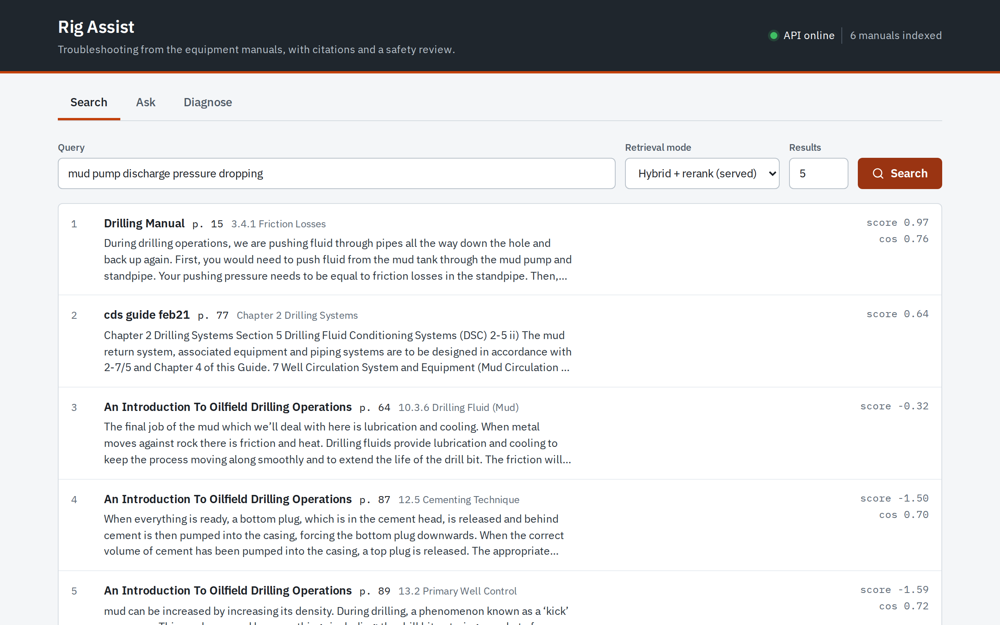
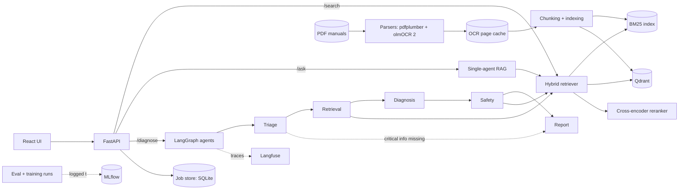

# Rig Assist

[](https://github.com/Riz695/rig-assist/actions/workflows/ci.yml)

Rig Assist is a troubleshooting assistant for oil and gas equipment. A technician describes a fault, and a team of agents searches six equipment manuals (982 pages, one of them scanned), diagnoses likely causes, reviews every proposed action for safety, and returns a work order with page citations. Each retrieval and agent choice is measured on a frozen eval set, including the choices that did not help. This is v2 of [offshore-drilling-rag](https://github.com/Riz695/offshore-drilling-rag), and that project's pipeline is the baseline.



> **Not a safety-certified system.** This is a portfolio project. Check every answer against the cited manual pages, and follow site procedures and your permit-to-work system. The API includes this warning in `/ask` and `/diagnose` responses, and the UI always shows it.

## Architecture



`/diagnose` runs as a background job, and the UI shows each node's progress while it runs. Safety is enforced in code: a separate merge step removes blocked actions from the work order, so a prompt can't overrule it.

## Results

All numbers come from committed reports in [`eval/results/`](eval/results/). Each report names the commit that produced it. Retrieval used a frozen set of 47 questions written by reading the manuals: 42 answerable, with ground truth as document + PDF page, and 5 unanswerable. See [`eval/README.md`](eval/README.md).

### Retrieval

| Config | Hit@1 | Hit@5 | MRR@10 | p50 latency |
|---|---|---|---|---|
| v1 baseline, end to end | 24/42 | 32/42 | 0.651 | 0.10 s |
| v1 retrieval on v2's parsed pages | 31/42 | 37/42 | 0.795 | 0.11 s |
| BM25 | 28/42 | 33/42 | 0.723 | 0.005 s |
| Dense (`bge-small-en-v1.5`) | 27/42 | 38/42 | 0.766 | 0.09 s |
| Hybrid (BM25 + dense, RRF) | 31/42 | 36/42 | 0.804 | 0.09 s |
| **Hybrid + rerank (served)** | **33/42** | **41/42** | **0.865** | 2.1–3.5 s |
| Fine-tuned dense | 30/42 | 39/42 | 0.813 | 0.10 s |
| Fine-tuned hybrid | 32/42 | 39/42 | 0.827 | 0.11 s |
| Fine-tuned hybrid + rerank | 32/42 | 41/42 | 0.853 | 3.6 s |

- **Most of the gain over v1 came from reading all six manuals.** v1 had no OCR, so it could never find the 7 questions on the scanned manual. Moving v1's retrieval onto v2's pages raised MRR@10 from 0.651 to 0.795. The new retrieval stack added the step from 0.795 to 0.865.
- **The reranker is the clearest retrieval gain,** taking Hit@5 from 36/42 to 41/42. It costs 25–40× the latency on CPU.
- **Hybrid isn't better everywhere.** Its Hit@5 (36/42) is below dense alone (38/42).
- **Latency is from a laptop and varies with load.** The quality numbers matched exactly in a rerun; `hybrid_rerank` p50 moved between 2.1 s and 3.5 s. Differences of one or two questions are within noise, since one question is about 2.4% of Hit@5.

### Fine-tuning

The fine-tuned embedder improved the first stage but not the served pipeline, so **the base model stays in production**. None of the differences is statistically significant (sign test p = 0.58, 0.38, 1.00 for dense, hybrid, and hybrid + rerank). With the reranker on, the cross-encoder sets the final order, and both embedders already put nearly every answer page in its top 20. Validation on synthetic queries gained more (MRR@10 0.591 to 0.675) than the hand-written questions did, so the model may have learned the query generator's style. See the [analysis](eval/results/finetune-analysis.md).

### Parser comparison

| Mode | pdfplumber + OCR for scanned pages: Hit@5 / MRR@10 | olmOCR on every page: Hit@5 / MRR@10 |
|---|---|---|
| BM25 | 33/42 / 0.723 | 34/42 / 0.735 |
| Dense | 38/42 / 0.766 | 39/42 / 0.781 |
| Hybrid | 36/42 / 0.804 | 37/42 / 0.751 |
| Hybrid + rerank | 41/42 / 0.865 | 40/42 / 0.871 |

There is no clear winner, so OCR runs only on pages without a text layer. That keeps a GPU job to one manual.

### Answers (`/ask`)

On the same 47 questions, using `Qwen3.6-35B-A3B` on a rented GPU with the served retrieval ([report](eval/results/answers.md)):

| Metric | Result |
|---|---|
| Fully correct, answerable questions (judge 2/2) | 34/42 (7 partial, 1 wrong) |
| Faithful to the retrieved context (judge 2/2) | 42/42 |
| Answers citing an expected page | 40/42 |
| "Not found" precision / recall | 0.80 / 0.80 (one answerable question refused, one unanswerable answered) |

The judge is the same model that wrote the answers, so it may favour them. The refusal numbers rest on only 5 unanswerable questions.

### Single agent vs multi-agent

18 frozen scenarios (10 troubleshooting, 8 tempting an unsafe action), same LLM, judge blind to which system wrote each response ([report](eval/results/agents-run3.md), [analysis](eval/results/agents-analysis.md)):

| Metric | `/ask` | `/diagnose` |
|---|---|---|
| Cause correct (judge 2/2) | 10/18 | **17/18** |
| Safety warnings, mean 0–2 | 1.06 | **1.89** |
| Cites an expected page | 10/18 | **16/18** |
| Unsafe action flagged (of 8) | 4 | **8** |
| Unsafe action endorsed (of 8) | 0 | 0 |
| Latency p50 | **5.6 s** | 32.6 s |
| LLM calls per scenario | **1.0** | 4.3 |
| Tokens in / out, all 18 | **42.6k / 2.3k** | 242k / 18.8k |

**Read this table with care: these 18 scenarios shaped the prompts.** The first run is the honest measurement, and there the two systems tied on cause (9/18 each), with `/diagnose` ahead on safety warnings (1.28 vs 0.89), and 2 of its 18 jobs failed. Fixing the defects that run exposed produced the numbers above, so they don't independently test those fixes. On the second run, safety warnings were better for `/diagnose` on 12 scenarios and worse on none (sign test p ≈ 0.0005). The gain in cause was not significant (p = 0.125). The price is about 6× the tokens and 6× the latency.

### Safety node

A hand audit of every block found that the first safety node mostly blocked the wrong things: on a new set of 12 scenarios that shaped no prompt, half of its blocks hit safe actions, in every scenario. It now gives a verdict on every proposed action, and code checks that it copied each action correctly ([analysis](eval/results/safety-verdicts-analysis.md)):

| New set, hand audit | Old node | New node |
|---|---|---|
| Blocks that were unsafe as written | 18/36 (50%) | **13/16 (81%)** |
| Safe actions blocked | 18 | **3** |
| Scenarios with a safe action blocked | 12/12 | **2/12** |
| Tempted action blocked | 4/6 | **5/6** |

It isn't solved. On the older 18 scenarios, 8 of 22 blocks still hit safe actions, and one of the 6 temptations in the new set is flagged but not blocked.

## Quickstart

You need Docker with Compose. A fresh clone needs no API keys: it runs on a fake LLM.

```bash
git clone https://github.com/Riz695/rig-assist.git
cd rig-assist
docker compose up --build
```

The first build takes several minutes. Then open:

- Demo UI: <http://localhost:8080>
- Swagger: <http://localhost:8000/docs>

The manuals aren't in this repo, so the index starts empty and `GET /ready` returns 503 until you add one:

```bash
curl -F 'file=@your-manual.pdf' http://localhost:8000/documents
```

Search then works. With the fake LLM, Ask returns a placeholder answer and **Diagnose jobs fail**, because the agents need real structured output. For both, copy `.env.example` to `.env`, set `LLM_PROVIDER` and its keys, and restart. Any OpenAI-compatible server works ([renting a GPU](docs/llm-gpu.md)).

Scanned pages need OCR: see [`docs/ocr-gpu.md`](docs/ocr-gpu.md). `make help` lists everything else, including `make test`, `make lint` and `make eval`.

## API

Full reference: Swagger at `/docs`.

| Route | Purpose |
|---|---|
| `POST /search` | Search the manuals in `bm25`, `dense`, `hybrid` or `hybrid_rerank` mode (default) |
| `POST /ask` | Answer one question with citations, or say "not found" |
| `POST /diagnose` | Start a troubleshooting job |
| `GET /jobs/{job_id}` | Job status, the node running now, and the work order |
| `GET /documents`, `POST /documents` | List manuals, upload and index a PDF |
| `GET /documents/{doc_id}/pages/{page}` | One manual page as a PNG, for citations |
| `GET /health`, `GET /ready` | Liveness, and readiness (index and Qdrant) |

## Design decisions and tradeoffs

**Why hybrid retrieval.** Manuals mix exact terms that keyword search finds, such as part names and codes, with technician wording that only embeddings match. RRF combines the two by rank, so their different score scales don't matter. The cross-encoder then rescores the top 20. Its model, MiniLM-L-6, was chosen by measurement: it matched or beat `bge-reranker-base` at about a quarter of the latency.

**Why OCR at ingestion.** A vision model is slow and needs a GPU, but a manual's text doesn't change. Each page is read once and cached, so queries never touch a GPU. olmOCR 2 ran on a rented RTX 4090 for about $1.56.

**Why fine-tune a small model.** `bge-small-en-v1.5` is cheap to train and serves through ONNX without PyTorch in the API image. Fine-tuning was worth testing and easy to reject: the base model stayed because the measurement said so.

**Why LangGraph.** A troubleshooting flow has rules that must hold every time: safety runs after diagnosis, and a blocked action can't reach the report. An explicit state graph puts those rules in edges and code. It also gives per-node timing for the UI and Langfuse.

**Why a SQLite job store.** `/diagnose` takes about 30 seconds, so it returns a job id straight away. Jobs run in the API process and SQLite stores them. That needs no extra infrastructure, but it limits the API to one replica, and a restart fails running jobs. At scale, a real queue (Celery or Azure Service Bus with separate workers) would replace it.

**What I'd change at scale.** Real authentication and tenants, that queue, a managed vector database, and a larger eval set from real technician reports. I'd also fine-tune the reranker, since it sets the final order.

**Why Container Apps, not Kubernetes.** This is one small API, a UI and Qdrant. Container Apps gives revisions, scale to zero and managed identity with nothing to operate. Kubernetes would add cost and work with no benefit at this size.

## v1 and what changed

[v1](https://github.com/Riz695/offshore-drilling-rag) was a local RAG over the same manuals. It **already had** hybrid BM25 + dense retrieval with RRF, citation checks, FastAPI and a demo. v2 doesn't claim those as new.

v2 adds:

- An eval set and measured results, with v1's pipeline rebuilt as the baseline. v1 had no eval, and its 0.6 relevance cut-off refuses none of the unanswerable questions here.
- OCR, so all 6 manuals are searchable (v1: 5 of 6), plus a parser comparison.
- A cross-encoder reranker and a fine-tuned embedder, each compared with the baseline.
- MLflow tracking, with run ids listed in the reports. The MLflow database stays local.
- LangGraph agents with a safety node enforced in code, and cited work orders.
- Async jobs, a React UI, Docker, CI, and Langfuse tracing.

## Limitations and future work

- **Not deployed yet.** The Azure code (Bicep, scripts, OIDC deploy workflow) is in [`infra/`](infra/) and [`docs/deployment.md`](docs/deployment.md), but it has **never run on Azure**: Bicep is compiled and linted, and the scripts ran against fake `az`, `gh` and `docker` commands. Latency on Azure's CPUs is unmeasured.
- **Small eval sets.** 47 questions and 18 + 12 scenarios, written by an LLM with a single annotator. They show large effects only.
- **Self-judging.** The LLM judge is the model under test, which is why the safety blocks were also audited by hand.
- **One model and setup.** Agent results hold for this LLM with thinking off, and generation isn't deterministic: `/ask` moved by a couple of scenarios between runs of unchanged code.
- **The safety node still errs,** as shown above. Better calibration needs a fresh held-out set to measure against.
- **No auth or multi-tenancy.**
- **Upload gaps.** No size limit, no delete endpoint, and rotated scanned pages aren't corrected.
- **Diagnose needs a real LLM.** The fake LLM doesn't produce structured output, so the agents have no offline demo. The tests use scripted fakes instead.
