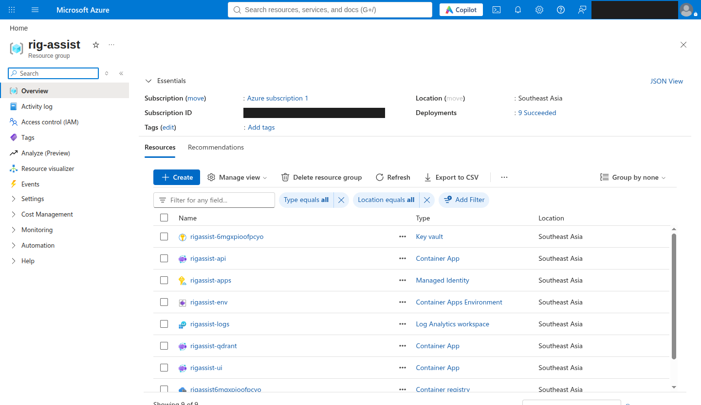
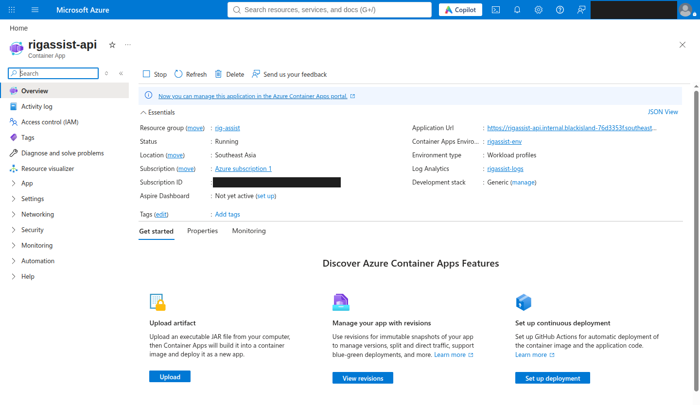
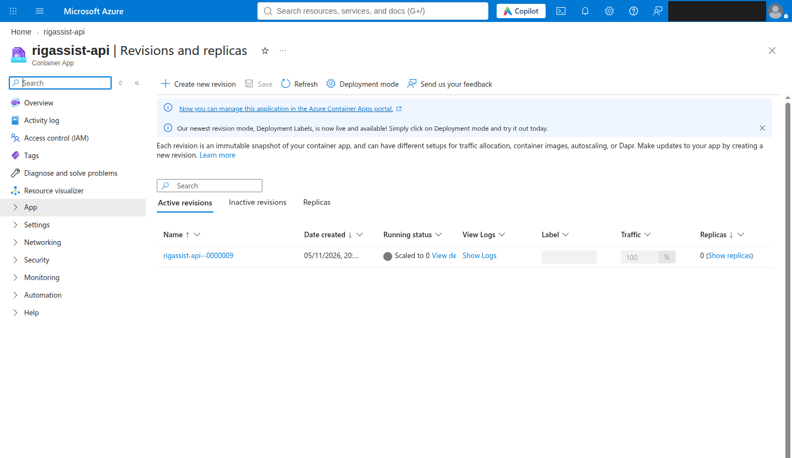
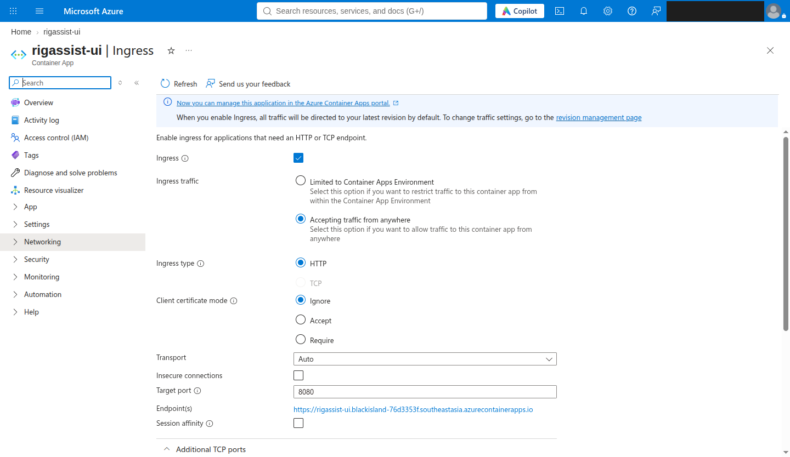
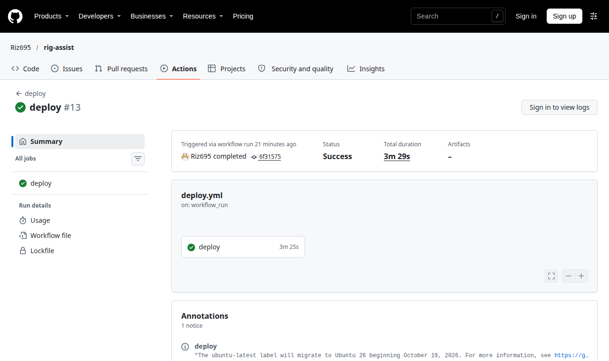

# Azure deployment evidence

Rig Assist ran on Azure Container Apps for a one-day test on 2026-11-05. The deployment was temporary and open only to one IP address, so there is no public URL. This page records what ran and what it proved.

The free trial was refused, so the test used a pay-as-you-go subscription with a $5 budget alert. Email, directory and subscription IDs are blacked out in the screenshots.

## What ran

All nine resources in the `rig-assist` resource group, in Southeast Asia:

| App | Replicas | Image |
|---|---|---|
| `rigassist-qdrant` | always 1 | `qdrant/qdrant:v1.19.2-unprivileged`, restored from a snapshot in Blob Storage |
| `rigassist-api` | 0 to 1 | `rig-assist-api:6f31575`, the merge commit |
| `rigassist-ui` | 0 to 1 | `rig-assist-ui:6f31575`, the merge commit |

The API scales to zero between uses. This is revision 9, after the merge deploy:

The UI's ingress is public at the network level. An IP restriction then refuses everyone else:

## Deploys from GitHub

A merge to `main` deployed through GitHub Actions, signing in with OIDC, with no stored password. [Run `42024247964`](https://github.com/Riz695/rig-assist/actions/runs/42024247964) built and pushed both images, swapped them in, and confirmed that the GitHub runner, as a foreign IP, got HTTP 403.

## Checks

| Check | Result |
|---|---|
| Qdrant restored from Blob Storage | 1,302 vectors |
| nginx to the API over the internal FQDN | working |
| Scale from zero | working |
| Browser walkthrough of Search, Ask and Diagnose | 0 console errors |
| Diagnose jobs in a row | 6, with 0 restarts |
| Langfuse trace link | present |
| Foreign IP | HTTP 403 |
| `hybrid_rerank` search | about 4.3 s on 1 vCPU |
| `/ask` | about 6.4 s |

## What the first real run found

Each of these passed linting and fake-command tests, and failed only on real Azure.

| Symptom | Cause | Fix |
|---|---|---|
| IP lookup timed out | One lookup service, which was unreachable | `92adc7f`: three services, forced IPv4 |
| `gpg: decryption failed: Timeout` on push | `az acr login` needs Docker's GPG-locked credential store | `655696f`: throwaway Docker config with a short-lived token |
| `DeploymentActive` | Top-level deployment and nested module were both named `apps` | `271d148`: renamed to `stage2` |
| `AADSTS700213` from GitHub | This repo's OIDC subject uses immutable ids | `2b18668`: read the subject prefix from GitHub |
| API exit 137 under repeated Diagnose jobs | Most likely out of memory at 2 GiB; inferred, because memory metrics came back empty | `906501f`: 1.25 vCPU / 2.5 GiB |

The deployment was then deleted with `make azure-teardown`, because a pay-as-you-go subscription has no spending cap. Left running, it would cost about $18-52 a month (calculated, not billed).
