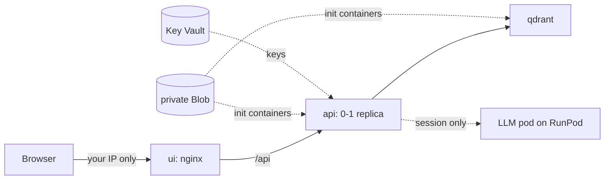

# Deploying Rig Assist to Azure

Rig Assist runs on Azure Container Apps on a free-trial subscription, reachable only from your
own IP address. Everything lives in one resource group, so teardown is one step. The
infrastructure is in `infra/` (see `infra/README.md`), the laptop scripts in `scripts/azure/`.

## Prerequisites

- A free-trial Azure subscription. The 30 days start at sign-up, so sign up when you are ready
  to deploy. Never upgrade it: a free trial cannot bill you, a pay-as-you-go subscription can.
- Azure CLI and Bicep: `uv tool install azure-cli==2.91.0`, then `az bicep install --version v0.48.1`.
- `az login`, `gh auth login`, Docker running, and `make up` with the index built (`make ingest`),
  because the data is copied from your local stack.
- In `.env`: `LLM_API_KEY`, `LANGFUSE_PUBLIC_KEY`, `LANGFUSE_SECRET_KEY`. `make azure-secrets`
  refuses to run if one is missing, because the API references all three.

## First deployment

Run these in order. The apps need images, data and secrets before they can start, and those
need the registry, storage and vault to exist, so deployment has two stages around the middle
steps. Each step is safe to rerun.

| Step | Command | What it does |
|---|---|---|
| 1 | `make azure-bootstrap` | Registers the resource providers, creates the resource group and the supporting resources, gives you write access to Blob and Key Vault, creates the GitHub identity and sets its repo variables |
| 2 | `make azure-publish-data` | Snapshots the local Qdrant collection, copies it, the index and the manuals to private Blob |
| 3 | `make azure-secrets` | Writes the three keys from `.env` to Key Vault and prints only their names and fingerprints |
| 4 | `make azure-apps` | Builds and pushes this commit's images, deploys `qdrant`, `api` and `ui`, and prints the URL |
| 5 | `gh variable set AZURE_DEPLOY_ENABLED --body true` | Switches on automatic deploys from GitHub Actions |

`RG=...` and `LOCATION=...` override the defaults (`rig-assist`, `southeastasia`) on every target.

After the deployment, `api` sits at 0 replicas and `qdrant` at 1. The LLM URL is a name that can
never resolve, so Search works but Ask and Diagnose need a session.

## Sessions

A session is a stretch with the LLM pod running, for checks or a recording. Follow this order,
because the pod bills by the second until it is terminated.

1. Read the stock and price on RunPod, then start the pod.
2. `make azure-session-start BASE_URL=https://<pod>-8000.proxy.runpod.net/v1` points the API at
   the pod, keeps one replica warm, refreshes the allowlist to your current IP, and waits until
   `/api/ready` answers through the UI.
3. Do the work.
4. `make azure-session-stop` clears the LLM URL and lets the API scale back to zero.
5. Terminate the pod and log the time and cost in `PROGRESS.md`.

If your home IP changes between sessions, `make azure-session-stop` refreshes the allowlist too.

## Deploys

A push to `main` runs `.github/workflows/deploy.yml` after CI passes, only while the repo
variable `AZURE_DEPLOY_ENABLED` is `true`; otherwise the job is skipped, never failed. It signs
in with OIDC (no stored password), pushes new images and swaps the tags.

Each swap holds the app at one replica until the new revision passes its probes, then restores
the previous setting, because at zero replicas a revision can report success without starting.
A failed deploy prints revision states only: Actions logs are public and app logs hold your IP,
so read those from the laptop with `az containerapp logs show`.

CI/CD never applies the Bicep. That needs rights to create role assignments, which the GitHub
identity should not hold, and it would reset your IP allowlist and session settings. After an
infrastructure change, run `make azure-apps` from the laptop, outside a session.

CI/CD swaps the main containers only: init containers keep the image from the last
`make azure-apps`. So a change to `rig_assist.deploy.blob_fetch` also needs `make azure-apps`.

## Teardown

`make azure-teardown` asks you to type the resource group's name, because this cannot be undone.
It deletes the resource group and waits, purges the soft-deleted Key Vault (it would otherwise
hold its name for 7 days), deletes the GitHub identity, sets `AZURE_DEPLOY_ENABLED` to `false`,
then checks each of these and exits non-zero if one is not done.

Then, by hand: delete the RunPod secret if nothing else uses it, and check the subscription's
cost view shows nothing still running.

## Cost

- **Free trial:** $0. The subscription has a $200 credit for 30 days and stops at either limit.
- **Afterwards:** the same stack on pay-as-you-go is not free. The Basic registry is a fixed daily
  charge, and `qdrant` keeps one replica running, so it never scales to zero. The design estimated
  about $5/month, which was not calculated with the always-on `qdrant` replica. Price it with
  the Azure pricing calculator before redeploying on a paid subscription.
- **LLM:** the RunPod pod, about $1 in total for the checks and the recording.

## Choices that differ from `PLAN.md`

- **Qdrant runs in Azure, not on Qdrant Cloud.** The plan's reason for Qdrant Cloud was that
  Qdrant on Azure Files risks corruption. This deployment uses no network storage: Qdrant's
  disk is an EmptyDir and it restores its collection from a snapshot in Blob at every start.
- **The LLM is Qwen on a RunPod pod, not Azure OpenAI.** The free trial has no Azure OpenAI quota.
- **The fine-tuned ONNX model is not published.** The eval results did not justify it, so the
  image bakes in the base embedder and reranker.
- **No Blob ingestion.** Azure serves a fixed index; ingestion stays on the laptop.
- **Images are built with `docker build` and `docker push`, not `az acr build`.** Microsoft Q&A
  reports ACR Tasks refused on trial credits (`TasksOperationsNotAllowed`).

## Limits

- One API replica at most: the SQLite job store and in-process jobs allow only one.
- Nothing written in Azure survives a replica: jobs, and any PDF uploaded through the API, are
  gone when it restarts or scales to zero.
- Data in Blob is overwritten by `make azure-publish-data`, not synced: a manual removed locally
  stays in Blob until you delete it.

## Troubleshooting

| Symptom | Likely cause and fix |
|---|---|
| `make azure-publish-data` or `make azure-secrets` answers 403 right after bootstrap | New role assignments take a few minutes to apply. Wait, then rerun |
| `make azure-publish-data`: connection refused on 6333 | The local stack is down: `make up` |
| A capacity or quota error in `southeastasia` | Try another region: `make azure-bootstrap LOCATION=...` on a new resource group |
| The site answers 403 | Your IP changed: `make azure-session-stop` refreshes the allowlist |
| An API revision fails | `az containerapp logs show -n rigassist-api -g rig-assist --container fetch-data --tail 50`: the init container exits 1 with one line naming a missing prefix or a sign-in failure |
| `az deployment` says a vault name is taken | A soft-deleted vault from an earlier teardown: `az keyvault purge --name <name>` |
