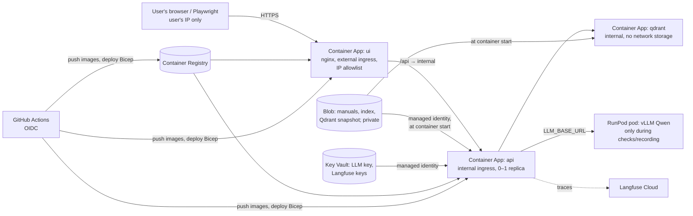

# Phase 8: Azure deployment + CD (design)

Status: draft for the user's approval (2026-10-28), updated after the builder check. Plan: `PLAN.md` → Phase 8, changed as below.

## Intent

Prove real Azure experience for ML/AI-engineer job applications at the lowest possible bill.
The deployment is **temporary and private**: it exists to (1) show infrastructure built properly
(infrastructure as code, keyless CI/CD, managed identity, secrets outside the image), (2) pass
Phase 8's acceptance checks, and (3) be what's on screen in the **recorded demo**. Recruiters
see the video and the repo, never the live site. Claude Code drives the demo run-through with
a scripted browser (as in the Phase 7 live check) against the Azure URL; it is recorded.

## Decisions (the user's)

- **New Azure account, kept on the free trial** ($200 credit, 30 days; never upgraded). The
  subscription can't bill; it lapses after 30 days or $200, so the deployment is temporary by
  design. Sign up only when building starts (the 30 days start at sign-up).
- **LLM stays off Azure:** the free trial has 0 Azure OpenAI quota. Ask/Diagnose use the same
  Qwen3.6-35B on a **RunPod GPU pod, started only for the acceptance checks and the recording**
  and terminated after (existing `openai_compatible` provider; ~$1 of the user's ~$5 RunPod
  credit). The demo then matches the eval results' model.
- **Only the user's IP** can reach the site (Container Apps ingress IP restriction).
- **Bicep** for the infrastructure.
- **The phase spans the user's merge** (two PRs): the pipeline is first tested from the
  `phase-8-azure` branch (a `push` trigger limited to that branch + a federated credential for it;
  GitHub allows `workflow_dispatch` only for workflow files already on `main`); the user merges the Phase 8 PR, and that merge is the first real push-to-`main`
  deploy, verified; then the recording, then the teardown, then a small closing PR (notes,
  PROGRESS). Sign up for Azure when the branch work is ready to deploy.
- **Claude runs the Azure commands** after the user's one-time `az login` (run with `!` in the
  prompt): bootstrap, deploys, session changes, teardown. Secrets reach Key Vault through a
  script that reads `.env` and never prints them; if the permission system blocks that, the
  user runs that one command.
- **Fallback if the free trial is refused or can't run Container Apps nearby: stop Phase 8's
  Azure part** and record the demo locally (`docker compose` + the RunPod pod). No upgrade.
- **Qdrant inside Azure** (not Qdrant Cloud): a Container App with no network storage that
  restores its collection from a snapshot in Blob at startup. PLAN's reason for Qdrant Cloud
  (Qdrant on Azure Files risks corruption) doesn't apply when Azure Files isn't used. Record
  the change in `docs/deployment.md`.

## Goals

1. `az deployment` of the Bicep files builds the whole environment in one resource group;
   deleting that resource group (plus the GitHub identity, see Teardown) removes everything.
2. A push to `main`, after CI passes, builds both images, pushes them to Azure Container
   Registry, and deploys, signing in with **GitHub OIDC** (no stored Azure password or key).
3. The demo works at the UI's Azure URL from the user's IP: Search, Ask, Diagnose (live
   progress, work order, citations with page images, Langfuse trace link).
4. `docs/deployment.md`: setup commands, cost note, the Qdrant change, teardown, tested.
5. Teardown is run for real and checked (resources gone, nothing billing).

## Non-goals

- A public or always-on demo; any traffic but ours.
- Azure OpenAI or upgrading the subscription.
- Persisting anything written in Azure: uploads (`POST /documents`) and the SQLite job store
  live on the container's ephemeral disk and vanish on restart (one replica, documented).
- Serving the fine-tuned embedder: it didn't beat the base model (`eval/results/finetune.md`),
  so the served default stays `BAAI/bge-small-en-v1.5` via fastembed. PLAN's "publish the
  fine-tuned ONNX model" step is dropped (say so in `docs/deployment.md`).
- Kubernetes, multi-region, autoscaling beyond 0–1.
- PLAN's "ingestion reads from Blob when configured" (**Claude's call**): Blob only feeds the
  containers at start, and uploads in Azure are ephemeral by design, so a Blob-backed ingestion
  path would be unused code. Dropped; `docs/deployment.md` says so.

## Anti-goals (failure even if it "works")

- Any charge to the user beyond the free trial and ~$1 of RunPod credit.
- A secret in Git, in an image, in a workflow log, or in a Claude transcript (keys go in via
  references: GitHub secrets / Key Vault / RunPod secrets, fingerprints only when checking).
- The manuals or their page images reachable by anyone else (IP restriction, private Blob).
- A red deploy on every push after the trial lapses (deploys must be switchable off).

## Constraints

- One API replica max (SQLite job store; `/diagnose` jobs run in-process). Scale 0–1.
- The API needs at runtime: `data/index` (BM25 + chunk store, ~8 MB), `data/raw` (the 6 PDFs,
  28 MB, for page images), the embedding and reranker models (~150 MB, downloaded by fastembed
  on first use today), and Qdrant with the `rig_assist_chunks` collection.
- `.env` and keys never leave the laptop except as secrets the platform resolves.
- Versions pinned and checked against current docs (Bicep, Container Apps API versions, GitHub
  actions by SHA, Azure SDK packages), per PLAN.md.
- CI stays green without Azure: Bicep lint/build runs in CI; deploy runs only when enabled.

## Approaches considered (for the infrastructure)

| | Trade-off | Chosen |
|---|---|---|
| **A. Bicep + GitHub Actions** | Azure-native IaC, no state file to host, teardown = delete the resource group; Azure-specific | **Yes** (user) |
| B. Terraform + GitHub Actions | More common in job ads and multi-cloud, but needs a remote state store with locking: more to set up and tear down | No |
| C. `az` CLI scripts | Quickest, but imperative, not infrastructure as code; reads as less mature | No |

Qdrant: Qdrant Cloud free tier (PLAN) vs **Qdrant as a Container App restoring a snapshot from
Blob** (user: inside Azure). No Azure Files either way.

## Architecture

- **Resource group** (one): Container Apps environment + Log Analytics workspace, three
  Container Apps (`ui`, `api`, `qdrant`), Container Registry (Basic), Storage account (private
  Blob container), Key Vault, one user-assigned managed identity for the apps (AcrPull, Blob
  Data Reader, Key Vault Secrets User). Region: one with free-trial capacity near the user
  (builder's call; Southeast Asia is the default to try).
- **UI app:** the existing `ui/Dockerfile` image; external ingress with an IP allowlist
  (parameter, the user's current IP); `API_UPSTREAM` = the API app's internal address. Check
  the nginx runtime-DNS resolver works inside Container Apps.
- **API app:** the existing API image; **internal ingress only** (reached through the UI's
  `/api` proxy). Liveness `/health`, readiness `/ready` (new, see below). Min replicas 0
  (normally), 1 while recording (parameter). Env from Bicep; secrets from Key Vault.
- **Qdrant app:** the same pinned `qdrant/qdrant` image as compose; internal; its storage is
  the container's ephemeral disk; at start it restores `rig_assist_chunks` from the snapshot
  file fetched from Blob (e.g. Qdrant's `--snapshot <file>:<collection>` startup option, or the
  recover API; builder checks current Qdrant docs).
- **Getting data in at start:** an init container (or startup step) per app copies its files
  from Blob into an ephemeral volume using the managed identity: the API gets `data/index` and
  `data/raw`; Qdrant gets the snapshot. Models: bake the fastembed models into the API image at
  build time (as the Dockerfile already does for tiktoken) or fetch them at start; builder's
  call, but cold start must not depend on Hugging Face being up during the recording.
- **One-time data publish** (from the laptop, a script/`make` target): create a Qdrant snapshot
  from the local compose Qdrant, upload it plus `data/index` and `data/raw` to the private Blob
  container. Rerun whenever the index changes.
- **Secrets:** Key Vault holds `LLM_API_KEY` and the Langfuse keys; Container Apps reference them
  through the managed identity (no values in Bicep, parameters files or workflow logs).
  `LLM_BASE_URL` (the RunPod pod's URL) is a plain setting changed per session. The vLLM key
  reaches the pod as a RunPod secret, as in the safety-fix runs.

## New code (tests first where it's logic)

- **`GET /ready`:** 200 only when the index is loaded and Qdrant answers with the collection;
  503 with the reason otherwise (PLAN listed it as deferred to Phase 8). Tests first with fakes.
- **Blob fetch helper** (if the start step is Python rather than a stock image): downloads a
  prefix to a folder, skips unchanged files, fails clearly on auth/missing blob. Tests first
  with a fake client; Azure SDK (`azure-identity`, `azure-storage-blob`) pinned, ≥ 2 weeks old.
- Snapshot/publish script: thin glue, tested where practical.

## CI/CD

- `ci.yml` gains a Bicep check (`az bicep build`/lint) so infra errors fail before deploy.
- **Split (Claude's call):** the full Bicep is applied **from the laptop** (bootstrap, and again
  whenever infra changes); CI/CD **only swaps image tags**. Why: applying Bicep creates role
  assignments, which would need Owner-level rights for the CI identity (least privilege is the
  better story); a full redeploy on every push would reset the per-session settings (IP
  allowlist, `LLM_BASE_URL`, min replicas); and the user's IP would otherwise sit in public
  Actions logs.
- `deploy.yml`: on push to `main` after CI succeeds (`workflow_run`), on push to
  `phase-8-azure` (pre-merge testing; removed after the merge), and on manual
  `workflow_dispatch` (works once the file is on `main`), **only if** the repo variable
  `AZURE_DEPLOY_ENABLED` is `true`: OIDC login (`azure/login`), build and push both images to
  ACR tagged with the commit SHA, update the `ui` and `api` Container Apps to the new tags,
  then verify **through Azure** (new revision provisioned and running, replica healthy, `/ready`
  via the platform's probe) since GitHub's runners can't reach the IP-restricted site.
- The GitHub identity (Entra app registration + federated credentials for `main` and for
  `phase-8-azure`) is created once by the bootstrap script, with only what tag swaps need on
  the resource group (AcrPush on the registry; Container Apps contributor on the apps). The
  branch credential is deleted after the merge is verified.
- Nothing personal in the repo or logs: the IP allowlist and session settings are deploy-time
  parameters from the laptop, not committed values or repo variables.

## Operating it (sessions)

A session = acceptance checks or recording: start the RunPod pod (stock read and price
quoted first), set `LLM_BASE_URL`, set API min replicas to 1, warm up, run Playwright (checks
or recording), set min replicas back to 0, terminate the pod. Log time and cost in PROGRESS.md.
If the user's IP changes, update the allowlist parameter and redeploy.

## Teardown

Script + doc: delete the resource group, delete the Entra app registration and its federated
credentials, set `AZURE_DEPLOY_ENABLED` to `false`, delete the RunPod secret if unused; then
verify (resource group gone, `az ad app` gone, nothing in the subscription's cost view).
Run for real before the phase ends, then redeploy is possible only on a new subscription
(documented with its ~$5/month scale-to-zero cost on pay-as-you-go).

## Acceptance (Phase 8, as adapted)

- The UI's Azure URL serves the full demo from the user's IP; another IP is refused.
- A push to `main` (with deploys enabled) redeploys automatically via OIDC.
- `docs/deployment.md` and the teardown are tested for real.
- Demo recording made (Playwright video) and stored outside Git (link in PROGRESS.md).
- Spend: $0 on Azure (free trial), RunPod time logged.

## Left to the builder

Exact Bicep module layout and API versions; the region if Southeast Asia lacks capacity; init
container vs startup script; baking vs fetching models; Qdrant restore mechanism; image tags;
resource names; how the Playwright recording is scripted and stored; whether a budget alert is
added (free trial can't bill, so optional).
